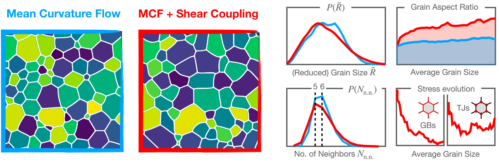



### Grain Boundary Kinetics and Grain Growth 

  

    

      
      
Fig. 1: The disconnection description of an arbitrarily curved GB (green curve) where the black lattice (representing one grain) and the white lattice (representing the other grain) meet together.

    

    

      
      
Fig. 2: Interface faceting-defaceting mediated by disconnections

    

    

      
      
Fig. 3: Grain rotation during grain growth mediated by disconnection

    

        

      
      
Fig. 4: Internal stress field evolution during grain growth and loss of correlation between GB velocity and curvature due to internal stress

    

    

      
      
Fig. 5: Statistics of grain growth considering shear coupling 

    

  

  <button type="button" class="fig-btn fig-prev" onclick="moveFigSlide(this, -1)" aria-label="Previous">&#10094;</button>
  <button type="button" class="fig-btn fig-next" onclick="moveFigSlide(this, 1)" aria-label="Next">&#10095;</button>
  

Despite decades of investigation, the classical mean curvature flow-description of grain growth fails to explain numerous experimentally observed phenomena. 
We resolved the longstanding discrepancies between theory and experiment by developing theory and a mechanism-based continuum model for grain boundary (GB) migration. 
GB migration in crystalline materials is mediated by disconnections, i.e., line defects constrained on GBs/interfaces possessing both step and/or dislocation character. 
Disconnection-description offers a unified description of GB kinetics, reconciling the shear-coupled migration and conventional capillarity-driven migration
We demonstrate that disconnection-mediated GB migration intrinsically generates internal stress field that, in turn, act on GB migration, which firmly demonstrates that realistic grain growth is disconnection flow instead of classical curvature flow. 
This work revised curvature-driven grain growth with a defect-dynamics-based framework, providing a unified and multiscale understanding of microstructure evolution.

**References**
1. **C. Qiu**, D. J. Srolovitz, G. S. Rohrer, J. Han, and M. Salvalaglio. “Shear-coupled grain growth statistics.” *Acta Materialia*, 317 (2026) 122494.
2. **C. Qiu**, D. J. Srolovitz, G. S. Rohrer, J. Han, and M. Salvalaglio. “Why grain growth is not curvature flow.” *Proceedings of the National Academy of Sciences*, 122 (2025) e2500707122.
3. **C. Qiu**, M. Salvalaglio, D. J. Srolovitz, and J. Han. “Disconnection flow–mediated grain rotation.” *Proceedings of the National Academy of Sciences*, 121 (2024) e2310302121.
4. Y. Tian, X. Gong, M. Xu, **C. Qiu**, Y. Han, Y. Bi, L. V. Estrada, E. Boltynjuk, H. Hahn, J. Han, D. J. Srolovitz, and X. Pan. “Grain rotation mechanisms in nanocrystalline materials: Multiscale observations in Pt thin films.” *Science*, 386 (2024) 49–54.
5. **C. Qiu**, M. Salvalaglio, D. J. Srolovitz, and J. Han. “Interface faceting–defaceting mediated by disconnections.” *Acta Materialia*, 251 (2023) 118880.

### Interface-Mediated Plasticity and Recrystallization Mechanism

  

    

      
      
Fig. 1: Description of first polycrystal figure

    

    

      
      
Fig. 2: Description of second polycrystal figure

    

  

  <button type="button" class="fig-btn fig-prev" onclick="moveFigSlide(this, -1)" aria-label="Previous">&#10094;</button>
  <button type="button" class="fig-btn fig-next" onclick="moveFigSlide(this, 1)" aria-label="Next">&#10095;</button>
  

Understanding the effect of interface on plastic deformation is important to understand, predict and design the mechanical behavior of materials. While it is well understood in homogeneous materials, the presence of interfaces in polycrystals and composites introduces strong constraints and heterogeneity for plastic deformation, fundamentally changing deformation pathways. My research demonstrates how interface properties control plastic deformation pathways and instability.  

Investigating the mechanisms governing microstructure evolution in polycrystals (i.e., grain growth and static/dynamic recrystallization), and developing theories, mechanism-based continuum models, and numerical methods to predict microstructure evolution in polycrystalline materials.

### Materials Behavior under Far-from-Equilibrium Conditions

  

    

      
      
Fig. 1: Description of first far-from-equilibrium figure

    

    

      
      
Fig. 2: Description of second far-from-equilibrium figure

    

  

  <button type="button" class="fig-btn fig-prev" onclick="moveFigSlide(this, -1)" aria-label="Previous">&#10094;</button>
  <button type="button" class="fig-btn fig-next" onclick="moveFigSlide(this, 1)" aria-label="Next">&#10095;</button>
  

Investigating defect dynamics, microstructure evolution, and mechanical/functional properties under far-from-equilibrium conditions, including rapid quenching, severe plastic deformation, impact loading, oscillatory driving, and strong temperature gradients.

### Bio-inspired Architected and Heterostructured Materials

  

    

      
      
Fig. 1: Description of first bio-inspired figure

    

    

      
      
Fig. 2: Description of second bio-inspired figure

    

  

  <button type="button" class="fig-btn fig-prev" onclick="moveFigSlide(this, -1)" aria-label="Previous">&#10094;</button>
  <button type="button" class="fig-btn fig-next" onclick="moveFigSlide(this, 1)" aria-label="Next">&#10095;</button>
  

Designing heterogeneous microstructures in polycrystalline and composite materials inspired by natural architectures (e.g., nacre, bamboo, leaves, and butterfly-wing scales) to overcome conventional property trade-offs and achieve multifunctionality.

### Physics-informed AI-assisted Materials Design

  

    

      
      
Fig. 1: Description of first AI-assisted design figure

    

    

      
      
Fig. 2: Description of second AI-assisted design figure

    

  

  <button type="button" class="fig-btn fig-prev" onclick="moveFigSlide(this, -1)" aria-label="Previous">&#10094;</button>
  <button type="button" class="fig-btn fig-next" onclick="moveFigSlide(this, 1)" aria-label="Next">&#10095;</button>
  

Integrating physical laws and mechanistic models with deep learning to efficiently navigate large processing and microstructure parametric spaces, combining predictive accuracy with mechanistic interpretability and advancing toward autonomous materials design.

