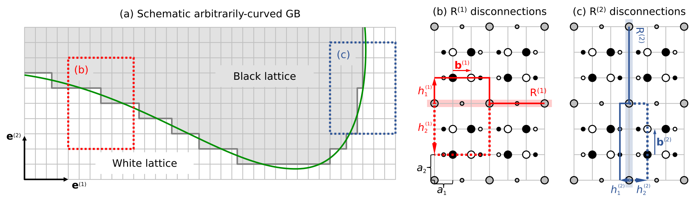



### Grain Boundary Kinetics and Grain Growth 

  

    

      
      
Fig. 1: The disconnection description of an arbitrarily curved GB (green curve) where the black lattice (representing one grain) and the white lattice (representing the other grain) meet together. 

    

    

      
      
Fig. 2: Interface faceting-defaceting mediated by disconnections

    

    

      
      
Fig. 3: Grain rotation during grain growth induced by disconnection flow along GB

    

        

      
      
Fig. 4: Internal stress field evolution during grain growth and loss of correlation between GB velocity and curvature (consistent with experimental measurements). 

    

    

      
      
Fig. 5: Grain growth statistics in classical mean curvature flow (MCF) framework and in our disconnection-based framework naturally conciling MCF and GB shear coupling. 

    

  

  <button type="button" class="fig-btn fig-prev" onclick="moveFigSlide(this, -1)" aria-label="Previous">&#10094;</button>
  <button type="button" class="fig-btn fig-next" onclick="moveFigSlide(this, 1)" aria-label="Next">&#10095;</button>
  

Grain growth in crystalline materials can be described by the motion of grain boundaries (or more generally, interfaces); hence, GB kinetics is theoretically important for understanding, predicting and controlling microstructure evolution. 
GB motion through mean curvature flow is considered in classical approaches developed by John von Neumann and William W. Mullins in 1950s, for which only the reduction of total GB free energy is accounted for. 
However, the classical mean curvature flow-description of grain growth fails to explain numerous experimentally observed phenomena, e.g., shear-coupled GB migration, grain rotation, low correlation between GB velocity and mean curvature, and internal stress generation along with GB motion, etc. 

As widely accepted in recent years, disconnections (line defects constrained on GBs possessing both step and/or dislocation character) mediate GB motion and provide a unified description of GB kinetics, reconciling capillarity and stress effects on GB motion.
**We resolved the longstanding discrepancies between theory and experiment by developing a disconnection-based and bicrystallography-respecting equation of motion for grain boundary (GB) migration** and implement it into numerical methods including *continuum front-tracking* and *phase-field modeling*. 
We demonstrate that disconnection flow along the GBs naturally governs GB faceting-defaceting transition, induces grain rotation and GB sliding, generates internal stress fields, stagnates grain growth, uncorrelates GB velocity and GB mean curvature, and leads to grain growth statistics consistent with experimental measurements.
**We demonstrated that realistic grain growth is disconnection flow instead of classical curvature flow**.
We modified the curvature-driven grain growth with a defect-dynamics-based framework, providing a unified and multiscale understanding of microstructure evolution.

**References**
1. **C. Qiu**, D. J. Srolovitz, G. S. Rohrer, J. Han, and M. Salvalaglio. “Shear-coupled grain growth statistics.” *Acta Materialia*, 317 (2026) 122494.
2. **C. Qiu**, D. J. Srolovitz, G. S. Rohrer, J. Han, and M. Salvalaglio. “Why grain growth is not curvature flow.” *Proceedings of the National Academy of Sciences*, 122 (2025) e2500707122.
3. **C. Qiu**, M. Salvalaglio, D. J. Srolovitz, and J. Han. “Disconnection flow–mediated grain rotation.” *Proceedings of the National Academy of Sciences*, 121 (2024) e2310302121.
4. Y. Tian, X. Gong, M. Xu, **C. Qiu**, Y. Han, Y. Bi, L. V. Estrada, E. Boltynjuk, H. Hahn, J. Han, D. J. Srolovitz, and X. Pan. “Grain rotation mechanisms in nanocrystalline materials: Multiscale observations in Pt thin films.” *Science*, 386 (2024) 49–54.
5. **C. Qiu**, M. Salvalaglio, D. J. Srolovitz, and J. Han. “Interface faceting–defaceting mediated by disconnections.” *Acta Materialia*, 251 (2023) 118880.

### Interface-Mediated Plasticity and Recrystallization Mechanism

  

    

      
      
Fig. 1: Description of first polycrystal figure

    

    

      
      
Fig. 2: Description of second polycrystal figure

    

  

  <button type="button" class="fig-btn fig-prev" onclick="moveFigSlide(this, -1)" aria-label="Previous">&#10094;</button>
  <button type="button" class="fig-btn fig-next" onclick="moveFigSlide(this, 1)" aria-label="Next">&#10095;</button>
  

Plastic deformation near interfaces is central to the mechanical response and microstructure evolution of many material systems. 
Such interface-mediated plasticity arises in bulk polycrystalline materials, heterogeneous materials, tribological contacts, and surface deformation processes. 
In some contexts, it governs the ability of materials to sustain deformation without failure; in others, it is deliberately exploited to generate defect structures, recrystallization, and tailored microstructures with enhanced properties. 
Understanding how interfaces control plastic flow is therefore a fundamental problem in materials science.

We explored

**References**
1. **C. Qiu**, W. Zheng, M. Salvalaglio, Y. Su, Q, Guo, D. Zhang, J. Han, and D. J. Srolovitz. “Inside interface-mediated plasticity.” *Submitted*, (2026).
2. **C. Qiu**, Y. Su, J. Yang, X. Wang, B. Chen, Q. Ouyang, and D. Zhang. “Microstructural characteristics and mechanical behavior of SiC(CNT)/Al multiphase interfacial micro-zones via molecular dynamics simulations.” *Composites Part B: Engineering*, 220 (2021) 108996.
3. X. Wang, Y. Su, **C. Qiu**, C. Zhu, X. Wang, H. Cao, D.Zhang, Q. Ouyang. “Mechanical behavior and interfacial micro-zones of SiCp (CNT) hybrid reinforced aluminum matrix composites.” *Materials Characterization*, 189 (2023) 111982.
4. **C. Qiu**, Y. Su, B. Chen, J. Yang, Z. Li, Q. Ouyang, Q. Guo, D. Xiong, D. Zhang, “First-principles investigation of interfacial stability, mechanical behavior and failure mechanism of β-SiC(1 1 1)/Al(1 1 1) interfaces.” *Computational Materials Science*, 175 (2020) 109608. 

### Materials Behavior under Far-from-Equilibrium Conditions

  

    

      
      
Fig. 1: Grain boundaries are Brownian ratchets that can perform directional motion under oscillatory driving and alter grain growth behavior.

    

  

  <button type="button" class="fig-btn fig-prev" onclick="moveFigSlide(this, -1)" aria-label="Previous">&#10094;</button>
  <button type="button" class="fig-btn fig-next" onclick="moveFigSlide(this, 1)" aria-label="Next">&#10095;</button>
  

Most natural and engineering systems are far from thermodynamic equilibrium.
Classical description of dynamic systems is assumed near equilibrium, typically described by free energy minimization towards thermodynamic equilibrium and Onsager linear force-flux relation. 
On the contrary, far-from-equilibrium (FFE) systems are continuously driven and exchanging energy and mass with their environments towards a non-equilibrium steady state instead of thermodynamic equilibrium. 
The nonlinear force-flux relation and history-dependent dissipation can lead to the emergence of self-organized phases with broken global symmetry/uniformity and high free energy. 
Therefore, controllable FFE processing can be promisingly used to produce phases that are inaccessible by classical nearequilibrium dynamics.
In materials science, FFE processing techniques (e.g., as additive manufacturing, rapid solidification, severe plastic deformation, and oscillatory external fields) enable the modulation and exploration of nonequilibrium microstructures that cannot be achieved under widely applied near-equilibrium materials processing. 

A typical example is the application of various oscillatory fields (e.g., mechanical, thermal, ...), as observed in experiments, promotes abnormal grain growth (AGG) and generates heterogeneous microstructures or single crystals.
**Our recent work demonstrates that GBs are natural Brownian ratchet and exhibit directional drifting motion under oscillatory driving.** 
We demonstrate that most GBs behave as Brownian ratchets, exhibiting unidirectional motion under oscillatory driving or cyclic thermal annealing. 
Our observations build on molecular dynamics and phase-field crystal simulations for a wide range of GB types and driving forces in both bicrystal and polycrystalline microstructures and we corroborate these simulation results through in situ experimental observations. 

**References**
1. **C. Qiu**, M. Punke, Y. Tian, Y. Han, S. Wang, Y. Su, M. Salvalaglio, X. Pan, D. J. Srolovitz, and J. Han. “Grain boundaries are Brownian ratchets.” *Science*, 385 (2024) 980–985.

### Bio-inspired Architected and Heterostructured Materials

  

    

      
      
Fig. 1: Description of first bio-inspired figure

    

    

      
      
Fig. 2: Description of second bio-inspired figure

    

  

  <button type="button" class="fig-btn fig-prev" onclick="moveFigSlide(this, -1)" aria-label="Previous">&#10094;</button>
  <button type="button" class="fig-btn fig-next" onclick="moveFigSlide(this, 1)" aria-label="Next">&#10095;</button>
  

Designing heterogeneous microstructures in polycrystalline and composite materials inspired by natural architectures (e.g., nacre, bamboo, leaves, and butterfly-wing scales) to overcome conventional property trade-offs and achieve multifunctionality.

**References**
1. J. Yang, **C. Qiu**, Y. Su, Z. Lin, X. Chai, X. Liu, L. Zhao, Q. Ouyang, and D. Zhang. “Crystal plasticity finite element modelling and mechanical deformation mechanism of nanolaminated graphene reinforced metal matrix composites.” *Composites Communications*, 44 (2023) 101768.
2. **C. Qiu**, Y. Su, J. Yang, B. Chen, Q. Ouyang, and D. Zhang. “Structural modelling and mechanical behaviors of graphene/carbon nanotubes reinforced metal matrix composites via atomic-scale simulations: A review.” *Composites Part C: Open Access*, 4 (2021) 100120.

### Physics-informed AI-assisted Materials Design

  

    

      
      
Fig. 1: Description of first AI-assisted design figure

    

    

      
      
Fig. 2: Description of second AI-assisted design figure

    

  

  <button type="button" class="fig-btn fig-prev" onclick="moveFigSlide(this, -1)" aria-label="Previous">&#10094;</button>
  <button type="button" class="fig-btn fig-next" onclick="moveFigSlide(this, 1)" aria-label="Next">&#10095;</button>
  

Integrating physical laws and mechanistic models with deep learning to efficiently navigate large processing and microstructure parametric spaces, combining predictive accuracy with mechanistic interpretability and advancing toward autonomous materials design.

**References**
1. X. Chai, Y.Su, Z. Lin, **C. Qiu**, X. Liu, X. Zhang, J. Yang, Q. Ouyang, and D. Zhang. “Mechanical property prediction and configuration effect exploration of particulate reinforced metal matrix composites via an interpretable deep learning approach.” *Materials Science and Engineering A*, 925 (2025) 147880.
2. Z. Lin, Y. Su, **C. Qiu**, J. Yang, X. Chai, X. Liu, Q. Ouyang, and D. Zhang. “Configuration effect and mechanical behavior of particle reinforced aluminum matrix composites.” Scripta Materialia, 224 (2023) 115135.

