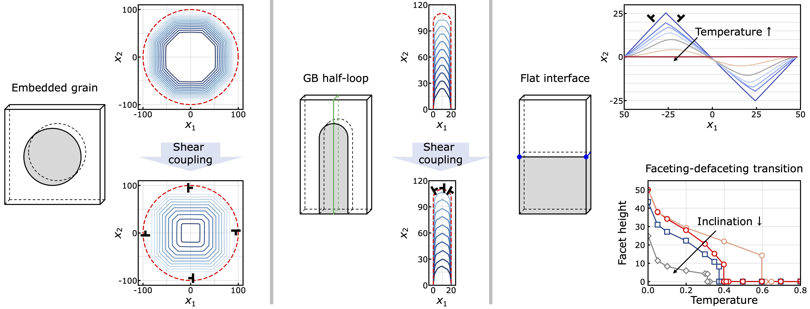



### Thermodynamics and Kinetics of Interfaces and Interface-Mediated Plasticity

  

    

      
      
Fig. 1: The disconnection description of an arbitrarily curved GB (green curve) where the black lattice (representing one grain) and the white lattice (representing the other grain) meet together.

    

    

      
      
Fig. 2: Interface faceting-defaceting mediated by disconnections

    

    

      
      
Fig. 3: Grain rotation during grain growth mediated by disconnection

    
 <!-- <-- THIS CLOSING TAG WAS MISSING -->
  

  <button class="fig-btn fig-prev" aria-label="Previous">&#10094;</button>
  <button class="fig-btn fig-next" aria-label="Next">&#10095;</button>
  

Developing theoretical, bicrystallography-respecting, disconnection-mechanism-based continuum models to describe interface/grain boundary thermodynamics (e.g., interface/GB energy and equilibrium interface/GB structure); diffusive and non-diffusive interface/GB kinetics (e.g., interface/GB diffusion, faceting-defaceting, roughening, and migration); and interface-mediated plasticity (e.g., dislocation–interface interactions). 

### Microstructure Evolution in Polycrystals

  

    

      
      
Fig. 1: Description of first polycrystal figure

    

    

      
      
Fig. 2: Description of second polycrystal figure

    

  

  <button class="fig-btn fig-prev" aria-label="Previous">&#10094;</button>
  <button class="fig-btn fig-next" aria-label="Next">&#10095;</button>
  

Investigating the mechanisms governing microstructure evolution in polycrystals (i.e., grain growth and static/dynamic recrystallization), and developing theories, mechanism-based continuum models, and numerical methods to predict microstructure evolution in polycrystalline materials.

### Materials Behavior under Far-from-Equilibrium Conditions

  

    

      
      
Fig. 1: Description of first far-from-equilibrium figure

    

    

      
      
Fig. 2: Description of second far-from-equilibrium figure

    

  

  <button class="fig-btn fig-prev" aria-label="Previous">&#10094;</button>
  <button class="fig-btn fig-next" aria-label="Next">&#10095;</button>
  

Investigating defect dynamics, microstructure evolution, and mechanical/functional properties under far-from-equilibrium conditions, including rapid quenching, severe plastic deformation, impact loading, oscillatory driving, and strong temperature gradients.

### Bio-inspired Architected and Heterostructured Materials

  

    

      
      
Fig. 1: Description of first bio-inspired figure

    

    

      
      
Fig. 2: Description of second bio-inspired figure

    

  

  <button class="fig-btn fig-prev" aria-label="Previous">&#10094;</button>
  <button class="fig-btn fig-next" aria-label="Next">&#10095;</button>
  

Designing heterogeneous microstructures in polycrystalline and composite materials inspired by natural architectures (e.g., nacre, bamboo, leaves, and butterfly-wing scales) to overcome conventional property trade-offs and achieve multifunctionality.

### Physics-informed AI-assisted Materials Design

  

    

      
      
Fig. 1: Description of first AI-assisted design figure

    

    

      
      
Fig. 2: Description of second AI-assisted design figure

    

  

  <button class="fig-btn fig-prev" aria-label="Previous">&#10094;</button>
  <button class="fig-btn fig-next" aria-label="Next">&#10095;</button>
  

Integrating physical laws and mechanistic models with deep learning to efficiently navigate large processing and microstructure parametric spaces, combining predictive accuracy with mechanistic interpretability and advancing toward autonomous materials design.

